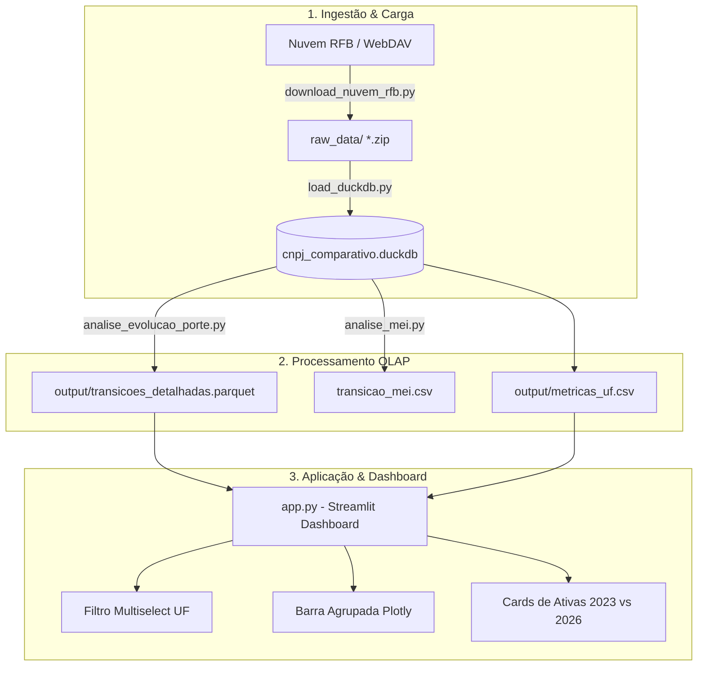

<div align="center">

# 📈 CNPJ Analytics — Inteligência & Dinâmica Empresarial

**Estudo Longitudinal e Dashboard Interativo sobre a Mobilidade de Porte, Sobrevivência e Crescimento Setorial das Empresas Brasileiras (2023 ➔ 2026)**

[](https://www.python.org/)
[](https://streamlit.io/)
[](https://duckdb.org/)
[](https://plotly.com/)
[](LICENSE)

[Visualizar Metodologia](METODOLOGIA_PORTE.md) • [Como Executar](#-como-executar) • [Estrutura do Projeto](#-estrutura-do-projeto) • [Principais Descobertas](#-principais-descobertas)

---

</div>

## 📖 Visão Geral

O **CNPJ Analytics** é uma plataforma analítica de Big Data projetada para processar, auditar e visualizar o ciclo de vida empresarial brasileiro a partir dos microdados abertos oficiais da **Receita Federal do Brasil (RFB)**.

O projeto compara o encerramento do exercício de **2023 (`2023-12`)** com a base de **2026 (`2026-06`)**, abrangendo mais de **68 milhões de estabelecimentos cadastrados** e **55,9 milhões de empresas comparáveis**. 

Por meio de um pipeline analítico em **DuckDB** e um **Dashboard Streamlit**, a aplicação revela:
- **Mobilidade de Porte:** Quantas empresas evoluíram (ex: de ME para EPP), regrediram ou estagnaram.
- **Desenquadramento do MEI:** Migração de Microempreendedores Individuais para portes superiores.
- **Dinâmica Regional e UF:** Filtro multiselect para comparar estados lado a lado (ex: Santa Catarina vs São Paulo).
- **Crescimento Setorial por CNAE:** Setores econômicos com maior tração e ascensão.
- **Taxa de Sobrevivência e Novos Entrantes:** Saldo líquido de abertura e proporção de matrizes ativas.
- **Ciclo de Vida Corporativo:** Coortes por idade e ano de fundação, identificando o período ótimo de expansão.

---

## 🚀 Funcionalidades Principais do Dashboard

### 1. 🎛️ Filtro Dinâmico de UFs e Modo Comparativo
- **Filtro na Barra Lateral:** Permite selecionar de 1 até todas as 27 UFs do Brasil (ou deixar vazio para ver o **Panorama Nacional**).
- **Gráficos Agrupados por UF (`barmode="group"`):** Quando 2 ou mais estados são selecionados, os gráficos de *Evolução de Porte* e *Crescimento Setorial* agrupam as barras lado a lado, viabilizando comparações diretas de market share e dinamismo regional.

### 2. ⚡ Consultas SQL Dinâmicas em Tempo Real (DuckDB OLAP)
- Todas as agregações são computadas via **CTEs em DuckDB SQL**, injetando cláusulas dinâmicas `WHERE uf IN ('UF1', 'UF2', ...)`.
- Graças à materialização analítica em colunar **Parquet**, as consultas cruzando dezenas de milhares de transições executam em **menos de 15 milissegundos**.

### 3. 📊 Cards de Métricas e Variação Proporcional
- Exibe métricas de topo (`st.metric`) com o número de empresas ativas em 2026 e o delta percentual (`+% vs 2023`), individualizados por cada estado selecionado.

### 4. 🧭 Abas Analíticas Especializadas
1. **📈 Evolução de Porte:** Transições entre Não Informado/Demais (`01`), Microempresa (`03`) e EPP (`05`).
2. **🏭 Crescimento Setorial:** Top CNAEs em volume de expansão, com descrição oficial da subclasse econômica.
3. **🗺️ Ranking Municipal:** Concentração e descentralização da ascensão corporativa por município.
4. **🛡️ Sobrevivência & Entrantes:** Relação entre total cadastrado, ativas (situação 02), baixadas e novos entrantes.
5. **⏳ Ciclo de Vida & Maturidade:** Curva histórica de abertura (2000-2023) e matriz de coortes por faixa de idade.

---

## 🏛️ Arquitetura de Dados



---

## 📊 Principais Descobertas do Estudo

| Indicador | Volume Nacional | Interpretação |
| :--- | :---: | :--- |
| **Base Comparável (2023 ➔ 2026)** | **55.911.128** | Empresas matrizes presentes em ambos os recortes |
| **Evoluções de Porte** | **167.075** | Empresas que expandiram formalmente seu enquadramento |
| **Regressões de Porte** | **22.561** | Empresas que reduziram de porte (ex: EPP ➔ ME) |
| **Taxa de Estagnação** | **99,54%** | Empresas estáveis em seu patamar de faturamento |
| **Razão de Dinamismo ($R_{din}$)** | **7,41x** | **7,4 empresas evoluem para cada 1 empresa que regride** |
| **Faixa Etária Crítica** | **4 a 7 anos** | Período de maturidade com maior probabilidade de ascensão (ME ➔ EPP) |
| **Empresas Ativas Brasil** | **21,8M ➔ 26,7M** | **Crescimento de +22,5%** de empresas ativas no cadastro da RFB |

> Para detalhamento matemático, definições jurídicas da LC 123/2006 e formulação das taxas, consulte o documento [METODOLOGIA_PORTE.md](METODOLOGIA_PORTE.md).

---

## 📂 Estrutura do Projeto

```text
cnpj-analytics/
├── app.py                      # Dashboard interativo principal (Streamlit + DuckDB + Plotly)
├── analise_evolucao_porte.py   # Script de engenharia e estudo analítico de mobilidade
├── analise_mei.py              # Script SQL para rastreamento de migração do MEI
├── download_nuvem_rfb.py       # Downloader via WebDAV com suporte a resume e integridade
├── load_duckdb.py              # Sanitizador de encoding e carga colunar em DuckDB
├── METODOLOGIA_PORTE.md        # Documentação metodológica e fórmulas estatísticas
├── requirements.txt            # Dependências do projeto
├── docker-compose.yml          # Configuração para orquestração de banco e serviços
│
└── output/                     # Artefatos processados de alta performance
    ├── transicoes_detalhadas.parquet  # Base colunar de transições indexada (189k linhas)
    ├── metricas_uf.csv                # Agregado histórico de ativas por UF (2023 vs 2026)
    ├── transicao_mei.csv              # Resultados da migração de MEI para outros portes
    ├── fluxo_transicao_porte.png      # Gráficos estáticos de alta resolução
    ├── perfil_setorial_cnae.png
    ├── perfil_regional_evolucao.png
    └── concentracao_ano_abertura.png
```

---

## 💻 Como Executar

### 1. Clonar o Repositório e Instalar Dependências

```bash
# Clone o repositório
git clone https://github.com/seu-usuario/cnpj-analytics.git
cd cnpj-analytics

# Crie e ative um ambiente virtual (recomendado)
python -m venv venv
# Linux / macOS:
source venv/bin/activate
# Windows:
venv\Scripts\activate

# Instale os pacotes necessários
pip install -r requirements.txt
```

### 2. Iniciar o Dashboard Interativo

Com os artefatos da pasta `output/` já gerados, basta rodar:

```bash
streamlit run app.py
```

O dashboard abrirá automaticamente no navegador em:  
👉 **`http://localhost:8501`**

### 3. (Opcional) Executar as Análises em Batch

Para reprocessar os cálculos ou exportar relatórios CSV complementares:

```bash
# Análise de migração de MEI (gera transicao_mei.csv)
python analise_mei.py

# Análise completa de mobilidade, CNAEs e gráficos PNG (gera arquivos em output/)
python analise_evolucao_porte.py
```

### 4. (Opcional) Reconstruir a Base DuckDB a partir do Zero

Caso deseje baixar e reprocessar os microdados brutos da Receita Federal:

```bash
# 1. Download dos arquivos ZIP oficiais via WebDAV
python download_nuvem_rfb.py

# 2. Carga, higienização de bytes e estruturação no DuckDB
python load_duckdb.py
```

---

## 🛠️ Stack Tecnológica

| Tecnologia | Função no Projeto |
| :--- | :--- |
| **[Python 3.12](https://www.python.org/)** | Linguagem central de desenvolvimento |
| **[DuckDB](https://duckdb.org/)** | Banco de dados analítico colunar (OLAP in-process de altíssima performance) |
| **[Streamlit](https://streamlit.io/)** | Framework para construção de dashboards analíticos modernos e responsivos |
| **[Plotly Express / Graph Objects](https://plotly.com/)** | Visualizações interativas dinâmicas e barcharts agrupados |
| **[Pandas](https://pandas.pydata.org/) & [PyArrow](https://arrow.apache.org/docs/python/)** | Manipulação de DataFrames e serialização otimizada em Parquet |

---

## 📄 Licença

Este projeto é disponibilizado sob a licença **MIT**. Veja o arquivo [LICENSE](LICENSE) para mais detalhes.

---

<div align="center">
Desenvolvido com foco em <b>Engenharia de Dados</b>, <b>Visualização Científica</b> e <b>Performance Analítica</b>.
</div>
